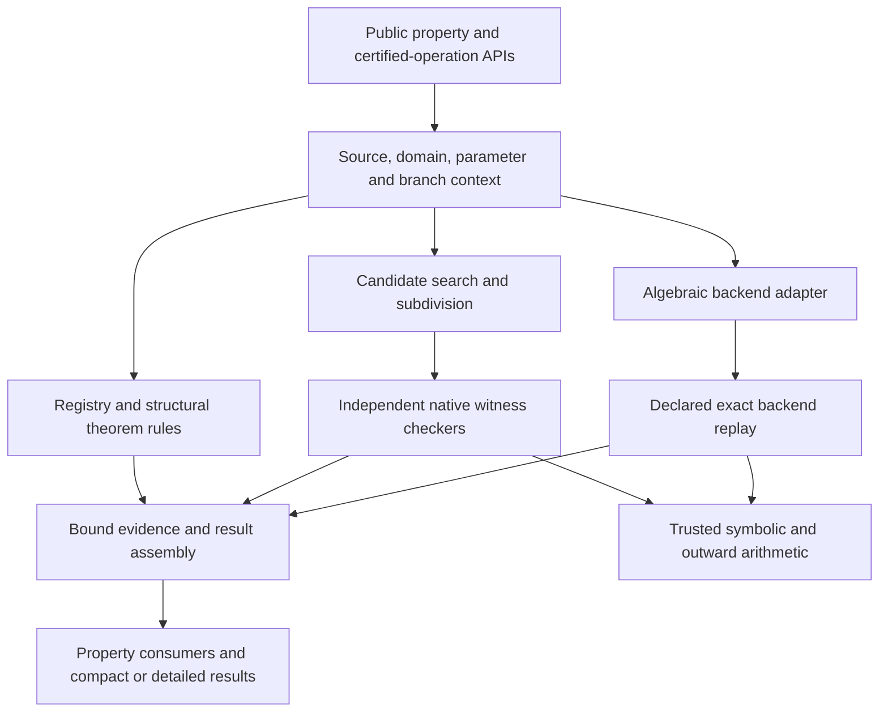

# Architecture and proof boundaries

Funcprops combines structural registry facts, symbolic transformations, exact algebraic backends and native witnesses. A successful route must retain the original source, requested domain, assumptions and branch context through its consumers. See [result contracts](reference/result-contracts.md) before treating any result as exhaustive.

## Module responsibilities

| Layer | Modules / responsibilities |
| --- | --- |
| Public queries | api.py normalizes property arguments, assumptions and return_result projection; __init__.py exports helpers and records |
| Facts and theorem routing | registry.py, immutable argument signatures, data resources, theorem routing and real_analysis modules provide guarded sufficient facts |
| Source/domain tracking | domain_tracking.py, algebraization.py and branch/Piecewise helpers retain raw holes, effective domains and first-match seam ownership |
| Finite property proof replay | metric_proofs.py checks finite secants and finite monotone motion/jump assemblies without their proposers |
| Polynomial parameter geometry | parameter_geometry.py checks degree strata, trace signatures, exact sign-prefix coverage and assumption-preserving specialization |
| Branch recipes | branch_gluing.py checks given holomorphic solutions and every overlap for a shared entire implicit relation |
| Exact algebraic support | algebraic_coefficients.py encodes bounded real fields by a uniquely isolated generator; semialg handles supported real constraints; algebraic_complex.py adapts algroots enumeration/certificates and filters against original principal-source restrictions |
| Native real kernel | coverage_contract.py and coverage_checker.py bind and check witnesses; enclosures.py supplies outward bounds |
| Real search and extensions | coverage_search.py, adaptive_roots.py, infinite/parameter/property modules propose compact partitions, tails, families, guarded boxes and consumer proofs |
| Complex contour kernel | complex_interval.py and analytic_contours.py check outward image boxes, zero-free boundaries and exact winding counts |
| Complex isolation | complex_isolation.py assembles exact rectangle covers; complex_cofinal.py schedules bounded attempts and conditional guarantees |
| Multiplicity and acceleration | complex_multiplicity.py and complex_newton.py supply checked location/order and Krawczyk witnesses, including all complement regions |
| Quotient ledger | quotient_isolation.py tracks numerator, denominator and original guards; shared_zeros.py proves shared orders; quotient_refinement.py and quotient_cofinal.py preserve that ledger |
| Factory-based operations | certified_operations.py, integration.py and real/transcendental helper families retain their declared replay contracts |
| Replay and inspection | verification.py selects registered concrete types; diagnostics.py reports replay status; proof_inventory.py exposes scoped release metadata |
| Resource control | work_budget.py implements supported isolated wall budgets; _source_transport.py retains held operands and coefficient domains across inputs, results and checkpoints |

## Search versus checking

Search may guess a root location, subdivision, identity or precision. A native checker must reconstruct its mathematical obligations from bound evidence without calling that search. Root exclusion and positive counts require witnesses; coverage requires exact geometry and clear shared boundaries. Failed proposals leave unresolved regions. Newton acceleration must preserve every complement and count. A conditional cofinal theorem never substitutes for a finite checked cover.

The algebraic adapter replays declared backend obligations. Some factory-based verifiers recompute through their original theorem factories. The inventory labels these differences; successful factory-based replay does not make it a native independent kernel. Static reachability in the inventory is approximate and is not an exhaustive capability or test-coverage claim.

## Transformation and consumer invariants

Transformations carry restrictions exactly or decline the route. Real/complex intermediate branches, denominator holes and assumptions must not disappear through cancellation. Consumers such as range/sign/monotonicity only assemble conclusions on certified effective cells, with endpoint and seam ownership. Unknown comparisons, missing parameter cases and unresolved tails stay visible. Source-preserving equivalence and meromorphic-extension equivalence are different relations; tests must choose the one their theorem uses.

## Trust and package boundaries

SymPy arithmetic, differentiation and declared identity oracles, outward interval primitives, semialg and algroots are trusted where used. This is not a formal proof-assistant development. Funcprops owns source/branch/domain policy and consumer assembly; algroots owns supported exact algebraic enumeration; semialg owns supported semialgebraic reasoning. Native nonalgebraic search/checkpoint contracts are currently inside funcprops; extraction into another package remains a design option, not a dependency already introduced here.

## Documentation and validation

Property metadata and executable examples generate the property reference and tour. Standalone workflow examples generate tutorials and the workflow notebook. Helper signatures and replay test inventories are generated and checked for drift. Every Python Markdown fence is executed as part of an ordered page session; notebook cells run in order. See [testing](guides/testing.md), [proof design](design/index.md) and [source semantics](source-semantics.md).
